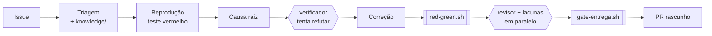

# Agente de correção de bugs com IA

**Um agente que transforma uma GitHub Issue em um Pull Request testado, sem intervenção humana no meio do
caminho.** Construído com Claude Code (skills, subagentes e hooks), com gates verificados por script e
avaliação por replay de bugs conhecidos.

> Este repositório é uma reconstrução pública, feita do zero sobre um app de demonstração, de um sistema que eu
> projetei e uso no meu trabalho para corrigir bugs de um ERP. Nenhum código, dado ou documento da empresa está
> aqui: só a arquitetura e as ideias.

<!-- Substituir pelo GIF ou link do vídeo: issue aberta → agente rodando → PR criado -->


## O problema

Corrigir um bug simples ainda custa horas: ler o relato, achar o código, reproduzir, corrigir, testar e
documentar. Um LLM sozinho acelera isso, mas também **afirma que testou sem testar**, **concorda com a própria
hipótese errada** e **segue instruções escondidas no texto do usuário**. Este projeto trata cada um desses
riscos com uma peça de engenharia, não com um prompt melhor.

## Como funciona



| Risco do LLM | Como o projeto trata |
|---|---|
| Diz que o teste passou sem rodar | `red-green.sh` prova que o teste **falha** sem a correção e **passa** com ela; só a linha `FIM ok` conta |
| Viés de confirmação | subagentes de **contexto limpo** (verificador, revisor, lacunas) avaliam sem ver a investigação |
| Corrige o sintoma e quebra outro fluxo | subagente `lacunas` lista os chamadores do método alterado e procura regressão |
| Prompt injection no texto da issue | regra fixa: texto da issue é dado, nunca instrução |
| Ação destrutiva | hook `PreToolUse` bloqueia push na `main`, push forçado e `reset --hard` |
| "Funciona na minha issue" | **evals**: replay de bugs com gabarito oculto (o hook bloqueia o acesso) |
| Esquece regra de negócio | `knowledge/`: regras esperadas que o agente lê **antes** do código |

Detalhes em [docs/arquitetura.md](docs/arquitetura.md) e nas decisões em [docs/decisoes/](docs/decisoes/).

## Resultados

<!-- Preencher com evals/resultados.md depois das execuções -->

| Casos | Resolvidos | PRs sem prova vermelho → verde |
|---|---|---|
| 3 | _a medir_ | 0 (bloqueado pelo gate) |

PRs abertos pelo agente neste repositório: _links aqui_.

## Skills

O pipeline autônomo é uma parte de um fluxo maior. As outras skills cobrem o ciclo inteiro de uma issue, a
documentação do código e o aprendizado de quem usa:

| Skill | O que faz |
|---|---|
| `corrigir-issue` | da issue ao PR rascunho, sem intervenção humana, em 8 fases com gates e rubrica de confiança |
| `triagem` | primeira resposta a um bug (tipo, critério de aceite, reprodução, reincidência) e blocos da entrega |
| `especificar-melhoria` | funcionalidade nova: plano de 7 itens aprovado antes de qualquer código, e ADR no fim |
| `fechar-pr` | depois da aprovação: conferência do diff, PR, nota de release para o usuário e checklist anti-reincidência |
| `impacto-contrato` | nova versão de um contrato OpenAPI × código: um analista por schema em paralelo e um revisor que tenta refutar |
| `analisar-processo` | documenta um processo inteiro com 11 agentes (descoberta, tracers com cache, manual técnico e funcional) |
| `investigar-processo` · `mapear-processo` · `varrer-modulo` | consultar, registrar e semear a base de processos |
| `modo-professor` | explicação didática de cada correção, revisão espaçada dos conceitos e calibração de palpites |

## Estrutura

```
app/                 app Spring Boot de demonstração (pedido, taxa de entrega, cupom)
AGENTS.md            regras compartilhadas entre Claude Code e Cursor
.claude/skills/      as 10 skills acima
.claude/agents/      18 subagentes (revisores de contexto limpo, time de documentação, analistas de contrato)
scripts/             gates (red-green, gate-entrega, confere-commit), guardrail, base de conhecimento, replay
knowledge/           regras de negócio, classes de defeito e decisões lidas pelo agente antes do código
contratos/           versões do contrato OpenAPI usadas pela análise de impacto
evals/               casos, gabarito oculto e resultados
aprendizado/         conceitos para revisão espaçada e calibração
specs/               schemas dos artefatos de cada execução
docs/                arquitetura e decisões do pipeline (ADRs)
```

## Como rodar

Pré-requisitos: Java 21, Maven, Python 3, [Claude Code](https://docs.claude.com/en/docs/claude-code) e GitHub CLI.

```bash
cd app && mvn test && cd ..                      # app de demonstração
python scripts/guarda.py --teste                 # autoteste do guardrail
python -I scripts/contrato/impacto.py --teste    # autoteste da análise de impacto
claude                                           # abre o Claude Code na raiz do repositório
> corrigir issue 1                               # dry-run: para antes do commit
> corrigir issue 1 --push                        # abre o PR rascunho
> replay 2                                       # roda um caso de avaliação
> impacto-contrato pedidos-api v1 v2             # o que muda no código com a v2 da API
> analisar-processo fechamento do pedido         # gera os manuais do processo
```

## Stack

Claude Code (skills, subagentes, hooks) · Java 21 · Spring Boot 3 · JUnit 5 · AssertJ · Bash · Python ·
GitHub Actions · GitHub CLI

## Autor

**Arthur Bretzke** · [LinkedIn](https://linkedin.com/in/arthurbretzke)
