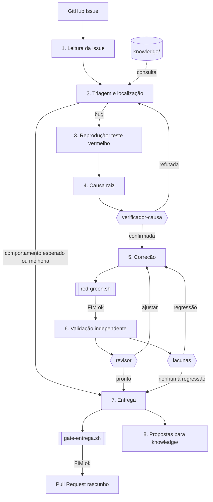
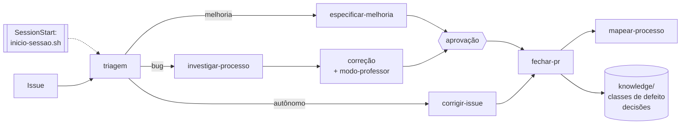

# Arquitetura

O pipeline é uma skill do Claude Code (`.claude/skills/corrigir-issue/SKILL.md`) que coordena o agente
principal e 3 subagentes de contexto limpo. Cada fase grava um artefato em `.runs/<issue>/` e só avança se o
gate da fase passar.

## Peças

| Peça | Arquivo | Papel |
|---|---|---|
| Orquestrador | `.claude/skills/corrigir-issue/SKILL.md` | define fases, gates e modos (dry-run, push, replay) |
| Verificador | `.claude/agents/verificador-causa.md` | tenta refutar a causa raiz antes de qualquer código |
| Revisor | `.claude/agents/revisor.md` | tenta quebrar a correção, sem ver a investigação |
| Lacunas | `.claude/agents/lacunas.md` | procura regressão e caminhos não cobertos |
| Prova | `scripts/red-green.sh` | teste falha sem a correção e passa com ela |
| Gate final | `scripts/gate-entrega.sh` | bloqueia o PR sem todas as evidências |
| Guardrail | `scripts/guarda.py` (hook `PreToolUse`) | bloqueia gabarito, push forçado e push na main |
| Contexto | `knowledge/` | regras de negócio que o agente lê antes do código |
| Avaliação | `evals/` | casos com gabarito oculto e tabela de resultados |

## O ciclo completo de uma issue

Fora do ciclo de issue: `impacto-contrato` (nova versão de API × código), `analisar-processo` e `varrer-modulo`
(documentação e semente da base).

## Por que subagentes de contexto limpo

O agente que investigou tende a concordar com a própria hipótese. O verificador e o revisor recebem só a issue
e o resultado, nunca o raciocínio, então avaliam a correção como alguém de fora. Detalhes em
[decisoes/002-verificador-contexto-limpo.md](decisoes/002-verificador-contexto-limpo.md).
